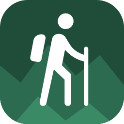
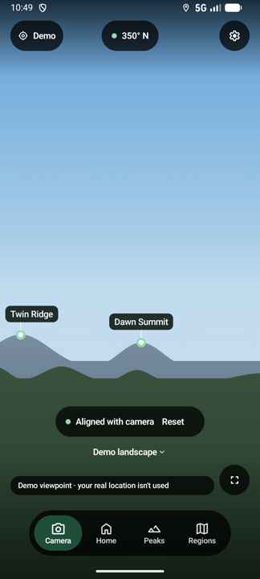
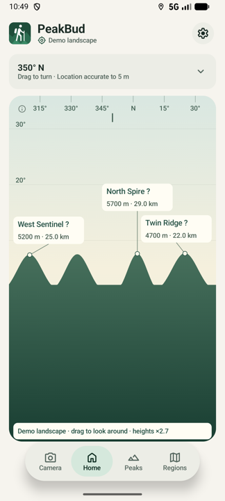
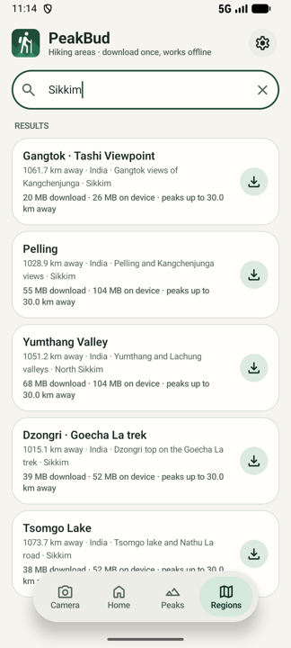

<p align="center">
  
</p>

<h1 align="center">PeakBud</h1>

<p align="center">Point your phone at the mountains and see their names. Works offline.</p>

<p align="center">
  
  
  
</p>

PeakBud is an Android hiking companion. It uses your GPS position, compass and a downloaded elevation map to work
out which summits are in view, then labels them on the live camera or on a drawn skyline. Nothing is uploaded and
no internet is needed on the trail once an area is downloaded.

## What it does

| Tab | Purpose |
| --- | --- |
| **Camera** | Full-screen camera with peak names. **Align with camera** matches the skyline the camera sees to the one the map predicts and corrects compass drift; manual nudge stays as a fallback. |
| **Home** | A drawing of the skyline around you, made from the map. Drag to look around, pinch to zoom, tap ⓘ for a key. Works indoors. |
| **Peaks** | Every nearby summit with height, distance, bearing and whether terrain blocks it. |
| **Regions** | Hiking areas to download (92 built in, mostly India), sorted by distance, plus a small **Near you** download. |

Also: a first-run tutorial (Settings → Help), **Demo mode** that runs everything on a made-up landscape and demo
camera footage, light/dark themes, metric or imperial units, landscape layout, and optional crash reporting.

Labels are estimates. Compass interference, GPS error, clouds and trees affect what you actually see.

## How it works

1. **Terrain.** Each area is a set of 1° elevation tiles (Mapzen/Tilezen Skadi, ~30 m) downloaded on demand and
   verified against SHA-256 checksums pinned in the app. Peak names come from GeoNames (CC BY 4.0) and ship in the APK.
2. **Visibility.** For every peak, a sight line is traced across the terrain, accounting for Earth curvature, to decide
   whether a nearer ridge hides it.
3. **Projection.** Peaks are placed on the camera preview using the phone's heading, pitch and roll and the camera's
   real intrinsics from CameraX.
4. **Camera alignment.** The app extracts the mountain–sky boundary from camera frames and registers it against a
   skyline predicted from your location and the terrain only (no reference photos). Ambiguous matches are rejected.
   See [the algorithm and validation notes](docs/camera-alignment-validation.md).

## Install

**From a build.** Download `app-debug.apk` and install it, allowing installs from unknown sources when prompted.
Requires Android 8.0 (API 26) or newer with GPS and a compass; a rear camera is needed for the Camera tab.

**From source.**

1. Install Android Studio with JDK 21 and Android SDK Platform 37.
2. Clone the repository and open it in Android Studio.
3. Optional: add `app/google-services.json` from your Firebase project to enable crash reports
   ([setup](docs/firebase.md)). The app builds and runs without it.
4. Run on a device, or from the command line:

```sh
./gradlew :app:assembleDebug                 # build
adb install -r app/build/outputs/apk/debug/app-debug.apk
./gradlew :app:testDebugUnitTest             # unit tests
./gradlew :app:connectedDebugAndroidTest     # instrumented tests (device or emulator)
```

On first launch, grant location and camera, open **Regions**, download an area near you, then try **Camera** or **Home**.

## Project layout

```
app/src/main/java/com/harsh/peakbud/
  core/          terrain engine, geometry, camera projection, skyline alignment (no Android dependencies)
  data/          region catalogue, downloads, HGT terrain reader, peak database, settings
  device/        GPS, orientation sensors, place names
  feature/       Compose screens: camera, home/panorama, tutorial
  telemetry/     Firebase logging and crash reporting
  ui/            theme, design tokens and string helpers
app/src/main/assets/regions/   built-in catalogue, peak lists and credits
tools/catalog/                 script that builds the catalogue from GeoNames and terrain tiles
docs/                          design notes, catalogue, alignment research and validation
```

Kotlin, Jetpack Compose, Material 3, CameraX, coroutines, Room and DataStore. Minimum API 26, target API 36.

## Data and credits

Terrain: Mapzen/Tilezen Skadi (SRTM and other sources, courtesy of the U.S. Geological Survey). Peak names:
[GeoNames](https://www.geonames.org/), CC BY 4.0. Each downloaded area lists its credits in the app.
More detail: [region catalogue](docs/region-catalog.md), [design system](docs/design-system.md),
[implementation status](docs/implementation-status.md).
