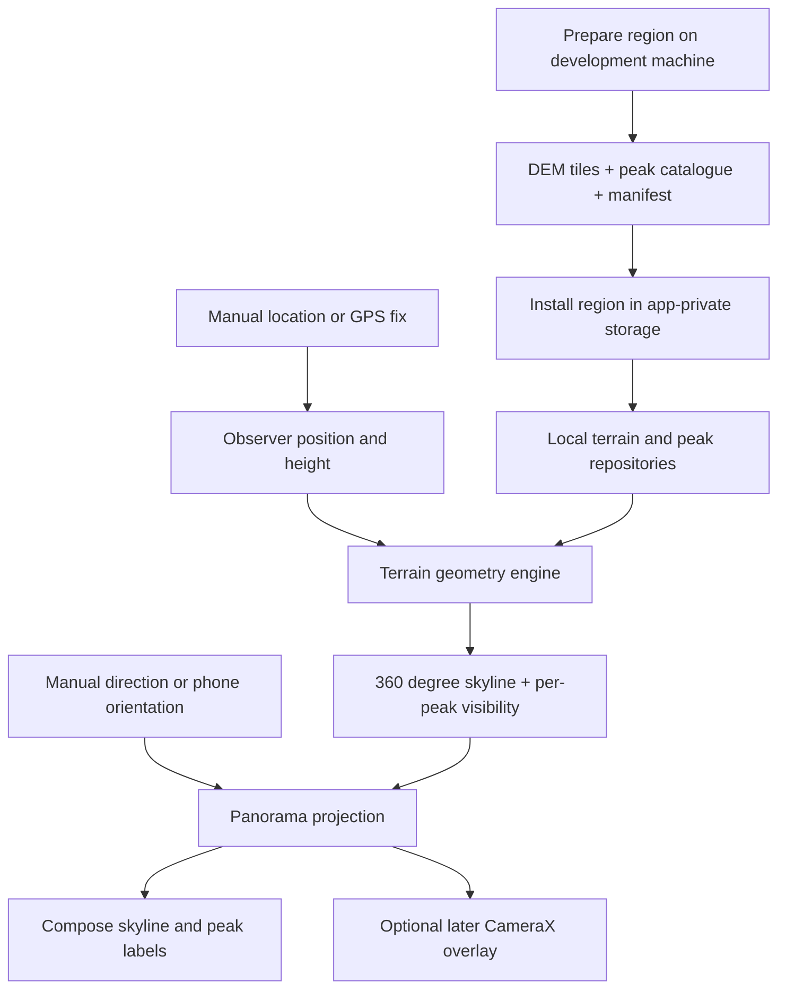

# PeakBud: DEM-Based Offline Peak Identification Plan

> Product direction update (2026-10-17): the primary experience is now a live rear
> camera preview with sensor-aligned peak labels, like the interaction requested
> by the user. The panorama remains an alternate reference/demo view. Camera
> preview and geographic overlays do not depend on computer vision. The original
> phases below describe the terrain foundation; camera integration has been
> brought forward. See [camera-overlay.md](camera-overlay.md) for the implemented
> pipeline, limits, and validation status.
> Region UX update: users select a built-in hiking area and tap Download. Remove
> import/file-picker and pasted URL flows. Peak snapshots, terrain URLs, hashes,
> sizes, and recipes ship in the app. GPS/compass status, location, altitude, and
> field of view must be visible; see [region-catalog.md](region-catalog.md).


Research date: 2026-10-17.

## 1. Recommended Approach

Build a terrain-based identification engine in Kotlin, draw its output with
Compose Canvas, and add device location and orientation progressively. DEM means
**digital elevation model**: a grid of ground or surface heights. A separate peak
catalogue supplies names and summit coordinates. Neither input alone is sufficient.

The phone does not initially recognize mountains from pixels. It calculates what
the surrounding terrain should look like from the observer's position, determines
which named summits have an unobstructed terrain line of sight, and projects their
labels into the direction the user is viewing.

Start with one curated Himalayan region, local SRTM elevation files, OSM peak
records, and a manually chosen viewpoint. Add GPS, compass alignment, region
downloads, and finally optional camera overlay after the geometry works.

This document records the proposed architecture and implementation sequence.
When it was written, the app displayed the Compose starter screen with dependencies
and manifest settings configured. Current progress and remaining verification are
tracked in [implementation-status.md](implementation-status.md). Public projects
below were inspected as references; they were not
built or field-tested during this research.

## 2. End-to-End Flow



Example: a hiker opens an installed Annapurna-region pack, selects a viewpoint,
and sees the generated skyline. PeakBud queries nearby named summits, calculates
their angles, checks intervening ridges, and labels the terrain-visible peaks.
Turning the phone changes the displayed direction without recalculating terrain.

The initial pack could cover the Poon Hill area. Confirm the actual viewpoint,
catalogue records, and reference panorama during fixture preparation; this is a
proposed demo location, not a verified test result.

## 3. What Public Implementations Teach Us

| Reference | Relevant implementation | Decision for PeakBud |
| --- | --- | --- |
| [PeakNavApp](https://github.com/Upabjojr/PeakNavApp) | Java/libGDX app with a separate [core](https://github.com/Upabjojr/PeakNavApp/tree/main/core), offline elevation, and named geographical data. | Separate terrain from peak metadata. Use it as a reference rather than bringing in its complete rendering stack. Its [GPL-3.0 licence](https://github.com/Upabjojr/PeakNavApp/blob/main/LICENSE) matters if reusing code. |
| [horizonator](https://github.com/dkogan/horizonator) | Desktop SRTM renderer: [DEM reader](https://github.com/dkogan/horizonator/blob/master/dem.c), [renderer](https://github.com/dkogan/horizonator/blob/master/horizonator-lib.c), and [OSM peak query](https://github.com/dkogan/horizonator/blob/master/query-peaks-from-osm.py). | Useful independent rendered-view comparison. Do not copy its assumption that absent DEM is zero elevation. README specifies LGPL; retain its [licence](https://github.com/dkogan/horizonator/blob/master/LICENSE) obligations for reuse. |
| [peakviewer](https://github.com/pascalbayer/peakviewer) | Browser terrain renderer with per-summit visibility, device alignment, and manual correction. | Recompute terrain on position changes; reproject on orientation changes. Browser caching does not replace a complete offline-region installer. [MIT licence](https://github.com/pascalbayer/peakviewer/blob/claude/peak-finder-mobile-pwa-ixawqh/LICENSE). |
| [Mountain-finder](https://github.com/Andre-Sanborn/Mountain-finder) | Local HGT and summit pipeline, with an explicit distinction between final skyline and visibility before the summit. | Check each summit against nearer terrain. Treat this as exploratory reference: its README leaves mobile execution unverified, and no licence was identified in the inspected root. |

These projects establish useful implementation patterns, not a guarantee of
accuracy on PeakBud's target devices. Write the initial Kotlin engine independently;
record commit hashes if any reference implementation later becomes a test oracle
or code dependency. The proposed design below is our engineering recommendation.

## 4. Data Sources and Initial Selection

### Terrain

| Source | Benefits | Constraints | Role |
| --- | --- | --- | --- |
| [NASA SRTMGL1 v003](https://data.nasa.gov/dataset/nasa-shuttle-radar-topography-mission-global-1-arc-second-v003-e47e1) | Approximately 30 m sampling; simple HGT files; coverage includes the Himalayas. | Coverage is approximately 60°N to 56°S. Filled cells and steep terrain need scrutiny. | Primary prototype source. |
| [Copernicus DEM GLO-30 Public](https://registry.opendata.aws/copernicus-dem/) | Approximately 30 m; anonymous AWS download; Cloud Optimized GeoTIFF. | Public 30 m coverage has some country gaps. It is a surface model including vegetation/buildings, and has its own licence. | Compare quality later; preprocess on desktop before mobile use. |
| [AWS/Mapzen terrain tiles](https://github.com/tilezen/joerd/blob/master/docs/formats.md) | Convenient tile access, including Terrarium PNG heights. | Mixed upstream sources and [regional attribution](https://github.com/tilezen/joerd/blob/master/docs/attribution.md). | Optional experiment, not the initial authoritative pack. |

Choose **SRTMGL1 v003 HGT** first. Download selected tiles through
[NASA Earthdata Search](https://search.earthdata.nasa.gov/search?q=SRTMGL1) on the
preparation machine; [Earthdata Login](https://urs.earthdata.nasa.gov/documentation/what_do_i_need_to_know)
may be required there. The installed app needs neither that account nor a live
elevation API.

The [SRTM user guide](https://lpdaac.usgs.gov/documents/179/SRTM_User_Guide_V3.pdf)
defines the reader contract: 1° tiles, 3601 × 3601 signed 16-bit big-endian samples,
north-to-south rows, shared boundary samples, and EGM96-referenced metre heights.
Infer the southwest origin from names such as `N28E083.hgt`. Handle `-32768` as
NoData. Keep source/version/attribution with the pack and preserve applicable
distribution terms. Do not assume all filled data has the same quality.

Each full-resolution tile is 25,934,402 bytes, about 24.7 MiB uncompressed
(3601 × 3601 × 2). Four tiles are about 98.9 MiB before peak data and packaging.
Determine the actual tile count from the supported area plus the viewing radius;
one tile is not automatically one usable hiking region. Start with original HGT
files and bounded file access; introduce smaller tiled formats only if profiling
or distribution size justifies them.

Copernicus uses a different vertical reference, EGM2008. A later adapter must
normalize or explicitly isolate datums; never merge its heights with SRTM heights
silently. Preserve the notices required by its
[dataset licence](https://dataspace.copernicus.eu/explore-data/data-collections/copernicus-contributing-missions/collections-description/COP-DEM).

### Named peaks

Use OpenStreetMap [`natural=peak`](https://wiki.openstreetmap.org/wiki/Tag:natural%3Dpeak)
records initially. Preserve coordinates, original and localized names, raw
elevation tags, normalized elevation when parseable, and source identifiers.
Treat missing or invalid elevation as missing. A DEM can supply geometry height;
keep that distinct from a catalogue's published summit elevation.

A small development extract can use Overpass:

```text
[out:json];
node["natural"="peak"](south,west,north,east);
out body;
```

Replace the bounds during preprocessing. Extract peaks over the viewing area,
including its surrounding radius, rather than just the walking area. For larger
packs, extract from regional OSM files instead of issuing repeated public queries.
Public Overpass servers are [shared infrastructure](https://dev.overpass-api.de/overpass-doc/en/preface/commons.html),
not the app's runtime backend. Ship attribution and meet the OSM database's
[ODbL requirements](https://www.openstreetmap.org/copyright), including applicable
share-alike/source availability obligations for a distributed derived catalogue.

[GeoNames downloads](https://www.geonames.org/export/) are an optional later
fallback. Keep their attribution and provenance separate. Their
[`elevation` and `dem` columns](https://download.geonames.org/export/dump/readme.txt)
have different meanings; neither should be blindly substituted for an exact
surveyed summit height. Avoid merging two peaks solely because names match.

## 5. Offline Region Preparation and Storage

Create a reproducible desktop preparation tool under `tools/prepare-region/`.
Python and desktop GDAL are suitable here; GDAL is not required inside Android.
Initial inputs may be manually downloaded files. The tool should:

1. Define a supported observer polygon and an initial maximum viewing radius of
   50 km. Include every terrain tile needed by that area expanded by 50 km,
   plus interpolation boundary samples. Radius is an explicit product limit.
2. Validate HGT sizes, bounds, tile edges, NoData coverage, and source versions.
3. Normalize the peak extract; preserve raw values, source IDs, and attribution.
4. Write pack metadata, hashes, known-viewpoint fixtures, and notices.
5. Verify completeness before packaging. Reject corrupt files; report incomplete
   coverage rather than synthesizing sea-level terrain.

Proposed pack layout:

```text
region-id/
  manifest.json
  terrain/N28E083.hgt
  terrain/...
  peaks.json
  attribution.txt
  licences/...
```

The manifest records schema version, region ID, pack version, supported observer
polygon, terrain bounds, viewing radius, horizontal CRS, vertical datum, source
versions/dates, peak extraction bounds, file sizes, and SHA-256 hashes. Parse the
small initial JSON with Android's built-in JSON support or add serialization when
implementing the installer. Use Room for imported peak metadata and installed-pack
records; retain original pack metadata for reproducibility.

For the first demo, bundle one prepared pack and extract it to app-private storage
once. Subsequent downloads should stage files, check available disk space and
hashes, validate paths against archive traversal, then activate the complete pack
atomically. Keep the previous valid version until activation succeeds. Large DEMs
belong outside automatic backups, for example under `noBackupFilesDir`.

Later add resumable HTTPS downloads and explicit installed/deleting/downloading/
failed states. Checksums detect corruption; if packs become remotely distributed,
authenticate the manifest or use signed manifests to establish publisher trust.
Do not embed Earthdata credentials in the APK. Region deletion must invalidate
affected calculations and caches.

## 6. Geometry and Visibility Engine

### Coordinate and height contract

Use WGS84 latitude/longitude in degrees, metres for distance and elevation, and
true-north bearings measured clockwise. Keep all geometric arithmetic in `Double`.
Wrap bearings at 360° and view-relative angles at ±180°. Define these conventions
once and test hemispheres, tile boundaries, and north-crossing views.

Initially use DEM height at the observer plus a configurable phone/eye offset
(default proposal: 1.6 m). This assumes the observer stands on the modelled ground;
bridges, cliffs, buildings, and coarse cells require manual height correction.

Android [`Location.altitude`](https://developer.android.com/reference/android/location/Location)
is ellipsoidal, while the selected DEM is orthometric. Do not mix them directly.
Optional MSL values on API 34+ require availability checks and still need a known
compatible reference. GNSS altitude becomes an input only after datum conversion
and uncertainty handling are implemented. Keep published summit height separate
from geometry height when its datum or provenance is uncertain.

### Candidate selection

Query Room by geographic bounds, then filter using actual distance ≤ viewing
radius. For each peak calculate distance, true bearing, and apparent elevation.
Use DEM summit height initially; retain catalogue height for display with its
source. Flag significant DEM/catalogue discrepancies for fixture review instead
of automatically raising the summit or snapping it to a nearby local maximum.

### Generate the terrain skyline

For each azimuth, sample outward through the DEM and retain the largest apparent
elevation angle and its distance. Start with 0.25° angular spacing for a draft
profile; refine to roughly one sample per horizontal output pixel as needed.
These are proposed resolutions to benchmark, not measured guarantees.

For the bounded initial region, a curvature-aware approximation is:

```text
apparentAngle(d) = atan2(terrainHeight(d) - observerHeight - d² / (2R), d)
skyline(azimuth) = maximum apparentAngle(d), for 0 < d <= viewingRadius
```

Here `R` is the chosen Earth radius and `d` is ground distance. Use the same model
for peaks and terrain. This is a spherical approximation, not a complete geodetic
solution. Include curvature from the first real DEM prototype. Start without
atmospheric refraction; record that choice in fixtures. Do not add curvature again
if a future ECEF/local-frame implementation already accounts for it.

Use near-field sampling tied to DEM cell traversal, with bilinear interpolation
where all required samples are valid. Avoid interpolating across NoData. Coarser
far-field stepping may accelerate the visual draft, but can skip thin ridges;
refine maxima and use a separate conservative check for peak visibility. Never
use coarse sampled terrain alone to claim accurate line of sight.

### Test each peak against nearer terrain

The final skyline can include mountains behind a summit. It is therefore not a
valid occlusion test for that summit. Trace its exact bearing only from the
observer to immediately before the summit, traversing intervening DEM cells.
Exclude the target endpoint while still checking its near-side approach.

```text
peakAngle = apparent angle of the summit
nearerMaximum = maximum terrain angle before the summit
clearance = peakAngle - nearerMaximum
```

Define outcomes with an uncertainty margin derived from DEM resolution/height
quality and observer uncertainty:

- `TERRAIN_VISIBLE`: clearance is safely above the margin and the path is covered.
- `OCCLUDED`: a known nearer obstruction safely exceeds the summit angle.
- `UNCERTAIN`: near-tangent path, uncertain heights, or sampling limitations.
- `UNKNOWN`: missing/corrupt terrain prevents a verdict; an already proven nearer
  obstruction may still justify `OCCLUDED`.

A valid zero-metre terrain cell is different from missing data. If a skyline ray
has gaps, mark that direction incomplete. A known maximum is only a lower bound
when some samples are unavailable. Restrict normal labels to confident candidates;
optionally expose uncertain ones with a distinct style and explanation.

Terrain-visible means unobstructed by the modelled terrain. Clouds, haze, trees,
and unmodelled objects can still prevent a hiker from seeing it. A visible summit
may appear against a taller mountain behind it rather than against the sky; the
renderer and label rules must support that case.

For longer ranges or demonstrated accuracy needs, replace the approximation with
ellipsoidal/ECEF geometry and compatible geoid conversion, then evaluate optical
refraction. Keep all such changes consistent across rendering and visibility.

## 7. Panorama, GPS, and Device Orientation

### First screen: a synthetic panorama

Draw a sky background, silhouette, cardinal directions, and peak callouts with
Compose Canvas. Provide manual coordinates, phone height, horizontal drag, and a
visible range/coverage indicator. Initially use a cylindrical panorama mapping:

```text
x = centreX + wrap180(peakBearing - viewHeading) / horizontalFov * width
y = horizonY - (peakElevationAngle - viewPitch) / verticalFov * height
```

Angles in this expression use the same units. Clip outside the viewport. This is
the panorama projection; it is not the later camera's perspective model. Keep
labels in stable non-overlapping lanes, with leader lines to their actual angular
positions. Tapping a peak shows name, height source, distance, and visibility state.
The first silhouette need not include textured terrain or internal ridge lines.

### GPS integration

Wrap Android [`LocationManager.GPS_PROVIDER`](https://developer.android.com/reference/android/location/LocationManager#GPS_PROVIDER)
behind a location interface. Present fix age and reported accuracy; handle denied
or approximate permission, stale fixes, disabled providers, and slow satellite
acquisition. Preserve manual location as a usable mode. GNSS can operate offline,
but offline acquisition time must be tested on devices rather than assumed.

### Orientation integration

Use Android's rotation vector with an accelerometer/magnetometer fallback. Apply
screen-rotation remapping and define the phone's viewing axis explicitly; the
rear-camera axis is different from simply reading the top edge's compass bearing.
Avoid relying on game rotation vector alone because it has no magnetic-north
reference. See [Android position sensors](https://developer.android.com/develop/sensors-and-location/sensors/sensors_position).

Convert magnetic to true heading using local
[`GeomagneticField`](https://developer.android.com/reference/android/hardware/GeomagneticField):
`trueHeading = wrap360(magneticHeading + declination)`. Smooth quaternions/angles
across the north boundary, monitor sensor accuracy, and provide manual yaw/pitch
trim. GPS bearing is direction of travel, not phone-facing direction. Save
calibration with clear reset semantics rather than treating one offset as
universally correct across locations and magnetic interference.

### Camera integration later

CameraX supplies the preview. Project cached peak vectors through the selected
lens's perspective/intrinsics and the same camera/display transform as the
preview, including crop, zoom, orientation, pitch, and roll. Do not place labels
using a hardcoded camera FOV or the panorama's linear mapping. Reference
[CameraX output transforms](https://developer.android.com/media/camera/camerax/transform-output).
Request camera permission when entering camera mode. Computer vision for skyline
alignment can follow after manual alignment and terrain projection are validated.

## 8. Proposed Code Scaffold

Keep one Android app module initially, with an Android-independent calculation
package. Split Gradle modules only if reuse or build boundaries justify it.
These were the proposed paths; consult the implementation status and source tree
for the current scaffold:

```text
app/src/main/java/com/harsh/peakbud/
  core/model/          Observer, Peak, TerrainSample, Visibility, Scene
  core/geo/            Bearings, distance, curvature, angle conventions
  core/terrain/        HorizonCalculator, PeakVisibilityCalculator
  core/projection/     PanoramaProjector, later CameraProjector
  data/terrain/        HgtReader, TileIndex, bounded cache, TerrainRepository
  data/peaks/          Room entities, DAO, PeakRepository
  data/regions/        PackManifest, installer, coverage validation
  device/location/     AndroidLocationProvider
  device/orientation/  AndroidOrientationProvider
  feature/panorama/    PanoramaViewModel, screen, canvas, label layout
  feature/regions/     Installed regions and later download UI
  feature/camera/      Later camera preview and overlay
tools/prepare-region/  Reproducible desktop pack generation
app/src/test/          Geometry, file-reader, visibility, pack tests
```

Minimal contracts, expressed as design sketches rather than complete Kotlin:

```kotlin
interface TerrainRepository {
    fun sample(point: GeoPoint): TerrainSample // Valid, NoData, Missing, Outside
}
interface PeakRepository {
    suspend fun candidates(bounds: GeoBounds): List<Peak>
}
interface LocationProvider { val fixes: Flow<ObserverFix> }
interface OrientationProvider { val poses: Flow<DevicePose> }

// Cancellable suspend calculations on a CPU dispatcher:
HorizonCalculator.calculate(observer, terrain, settings): HorizonProfile
PeakVisibilityCalculator.evaluate(observer, peak, terrain): VisibilityResult
PanoramaProjector.project(scene, pose, viewport): ProjectedScene
```

`TerrainRepository.sample` should read an already available bounded buffer, not
perform an unannounced network call. Preload required blocks on `Dispatchers.IO`;
perform calculations on `Dispatchers.Default`. Use cancellation checkpoints and
bounded worker counts. A missing block must remain explicit while it loads.

Important model fields:

- `ObserverFix`: coordinates, geometry height/datum/source, phone-height offset,
  timestamp, horizontal/vertical uncertainty, manual or GPS origin.
- `Peak`: source ID, coordinates, names, published height/source, geometry
  height/datum, provenance and pack version.
- `HorizonProfile`: angle/distance per bearing, coverage mask, calculation settings.
- `VisibilityResult`: verdict, clearance, blocker distance, missing-data reason.
- `DevicePose`: quaternion, true heading, timestamp, sensor/calibration quality.
- `Scene`: observer and pack version used, horizon, peaks, progress, freshness.

Use `StateFlow` in the ViewModel and lifecycle-aware Compose collection. DataStore
holds units and view preferences. Room holds metadata, not millions of terrain
samples. The existing CameraX, coroutines, Room/KSP, DataStore, and lifecycle
dependencies cover this scaffold. Add networking/WorkManager only at the download
phase, and geodesy/serialization libraries when their concrete use is defined.

## 9. Responsiveness and Resource Budget

Recompute terrain when the observer moves meaningfully, height/settings change,
or the installed pack changes. Set movement thresholds using fix uncertainty and
terrain resolution, then measure them; do not recompute for every noisy GPS fix.
Use latest-request cancellation and prevent stale jobs from overwriting new scenes.

Orientation updates only reproject the cached world-space scene. Target smooth
30–60 fps rotation on a named test phone. Initial engineering targets are a draft
panorama within 2 seconds and refinement within 5 seconds for a 50 km fixture,
with a terrain cache initially capped around 64 MiB. These are targets requiring
measurement, not current performance claims. Memory maps also consume resources;
bound buffers, tile handles, and resident pages rather than mapping every file.

If CPU sampling misses these targets, first profile tile access, allocations,
interpolation and cancellation. Then consider coarse-to-fine sweeps, cached
observer cells, conservative elevation hierarchies, or GPU terrain meshes. Coarse
approximations must not turn uncertain occlusion into confident visibility.

Stop location/sensor work when the relevant screen is inactive. The initial app
uses foreground location; background tracking is a separate future requirement.

## 10. Implementation Milestones and Acceptance Gates

| Phase | Deliverable | Acceptance gate |
| --- | --- | --- |
| 0. Establish baseline | Sync API 37.0 project, build, run existing tests. | `:app:checkDebugAarMetadata`, `:app:assembleDebug`, and `:app:testDebugUnitTest` pass in an unrestricted development environment. |
| 1. Synthetic scaffold | Core models, fake terrain, manual observer, Compose panorama. | Known peaks project correctly; north wrap and view dragging work; a nearer synthetic ridge hides a farther peak. |
| 2. Real offline terrain | HGT reader, pack validator, one curated region and catalogue. | A cold start in airplane mode renders the fixture; missing/corrupt tiles produce explicit incomplete coverage. |
| 3. Reliable visibility | Curvature, precise per-peak rays, uncertainty states and labels. | Analytic occlusion tests and independently generated terrain references agree within documented tolerances. Behind-summit terrain never hides a nearer visible summit. |
| 4. GPS and compass | Permission flow, fix quality, true heading, pose remapping, calibration. | Manual mode still works; portrait/landscape and all cardinal directions are checked on hardware; rotation does not rerun terrain calculations. |
| 5. Region management | Offline packs, resumable download, versioning, deletion and attribution. | Interrupted download cannot activate a partial pack; installed regions work after process death without a network. |
| 6. Optional camera | CameraX preview and calibrated overlay. | Labels stay aligned through supported crop/zoom/rotation configurations within a measured device-specific error budget. |

The first useful prototype ends after phase 3: real offline terrain, manual
viewpoint, generated panorama, and defensible labels. Phases 4–5 make it a practical
hiking companion. Camera and image recognition do not block those milestones.

## 11. Validation Strategy

Use deterministic tests for substantive geographic behavior:

- HGT byte order, southwest naming including southern/western hemispheres,
  row ordering, shared edges, interpolation, valid zero heights, and NoData.
- Bearings/distance, north crossing, unit conversions, and curvature on analytic
  flat/spherical fixtures. Record all height conventions and observer offsets.
- Near ridge hides far peak; far ridge does not hide near peak; aligned peaks at
  different distances; narrow ridge between coarse sample bearings; tangent
  summit; missing tile before a target; target outside installed coverage.
- Label overlap/selection and stable placement through heading changes.
- Pack integrity, insufficient disk space, interrupted installs, and version changes.

Create desktop reference views using [horizonator](https://github.com/dkogan/horizonator)
or an independent terrain implementation. Compare visibility with
[`gdal_viewshed`](https://gdal.org/en/stable/programs/gdal_viewshed.html) on a suitable
projected metric DEM, matching observer/target heights and curvature settings.
For the initial no-refraction model use curvature coefficient `-cc 1`; GDAL's
default differs. Validate/mask input NoData, and allow for resampling differences.
This is an independent cross-check, not proof of physical visibility.

For field validation, capture GPS quality, device orientation, manual calibration,
pack version, timestamp, and panorama photographs at several verified viewpoints.
Compare against independently identified summits, not just another app's labels.
Log angular error and visibility classification errors; derive tolerances from
actual device/DEM performance before claiming accuracy. Include airplane-mode
cold start, no compass, approximate GPS, stale fixes, and low-memory scenarios.

## 12. Limits and Decisions to Revisit

- DEM spacing does not guarantee sharp summit detail or corresponding vertical
  accuracy. A 30 m model can miss a narrow ridge or misplace the observer's ground.
- Peak catalogues can omit, duplicate, or mislocate summits. Preserve provenance;
  curate demo fixtures without inventing names or assigning uncertain identities.
- Compass interference can dominate label alignment even with correct terrain.
  Manual correction remains part of the intended experience.
- The initial 50 km radius omits more distant peaks; display the limit explicitly.
  Expand to 100–150 km only with complete data and validated geometry/performance.
- DEM line of sight does not establish weather-dependent visibility. Show the
  distinction plainly in peak details.
- Confirm redistribution notices for every packaged source. Keep OSM derived
  database obligations distinct from the application's code licence.
- No global map engine, recognition model, online elevation service, or backend
  is necessary for the first prototype. Downloads can later use static hosting.

## 13. Immediate Next Implementation

Implement phase 1 first: pure Kotlin geometry models, a synthetic ridge fixture,
manual observer controls, and a Compose panorama with a few test peaks. In
parallel with later implementation, prepare and inspect one real SRTM/OSM pack.
Then replace the fake repositories with local HGT and Room adapters while keeping
the same calculation and rendering contracts.

All architecture, budgets, and phase gates above are proposals. This research
delivers the scaffold and plan; it does not claim that real datasets have been
downloaded, public repositories executed, or terrain accuracy verified yet.
